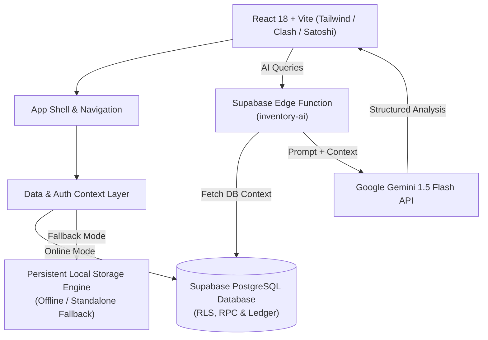

# INVENTORY MANAGER — AI-POWERED MONOCHROMATIC SAAS

A production-grade, AI-powered inventory operations platform engineered with a strict monochromatic Swiss luxury-brutalist aesthetic. Designed for small businesses, retail stores, and warehouse facilities.

---

## 1. Product Overview

Inventory Manager provides real-time stock control, automated replenishment analysis, immutable ledger accounting, and AI intelligence powered by Google Gemini and Supabase PostgreSQL.

### Key Capabilities
- **Product Management:** Complete CRUD with unique SKU validation, category segmentation, pricing, and reorder thresholds.
- **Atomic Stock In / Stock Out:** Thread-safe inventory transactions with row-level locking (`SELECT ... FOR UPDATE`), ledger history, and non-negative stock enforcement.
- **Real-Time Valuation:** Live asset valuation at purchase cost and retail potential across categories.
- **Supplier Roster:** Full supplier lifecycle management with direct SKU relationship mapping.
- **Reporting & CSV Exports:** Multi-dimensional analytics (Valuation, Movement Velocity, Fast/Slow-Moving, Deadstock, and Low-Stock action lists) with one-click CSV downloads.
- **AI Inventory Intelligence:** Google Gemini integration via Supabase Edge Functions with verified database context injection, executive briefings, and natural-language query resolution.
- **Global Search:** Instant modal search (`Ctrl+K` / `Cmd+K`) across catalog items, SKUs, vendors, and transactions.

---

## 2. Strict Monochromatic Design System

The application strictly adheres to a luxury-brutalist, typography-first Swiss aesthetic:
- **Palette:** `#000000` (pure black), `#111111` (near black), `#1e1e1e` (luxury dark), `#333333` (dark grey), `#777777` (medium grey), `#b6b5b5` (muted grey), `#d9d9d9` (light grey), `#f2f2f2` (off-white background), `#ffffff` (pure white).
- **Zero Color Accents:** No blue, green, red, orange, purple, or yellow accents. All status indicators, badges, and charts use monochromatic patterns, contrast, and typography.
- **Typography:** **Clash Display** for oversized, high-impact headlines and **Satoshi** for functional body text, paired with **JetBrains Mono** for data tags and transaction codes.
- **The Typographic Echo Stack:** Multi-layered offset text styling providing depth and rhythm.

---

## 3. Technology Stack

- **Frontend:** React 18, Vite, TypeScript, Tailwind CSS, Lucide React, Recharts.
- **Backend / Database:** Supabase, PostgreSQL, Row Level Security (RLS), Supabase Edge Functions.
- **AI Integration:** Google Gemini API (`gemini-1.5-flash`).
- **Tooling:** Git, TypeScript 5.6, PostCSS, Autoprefixer.
- **Deployment:** Vercel.

---

## 4. System Architecture



---

## 5. Database Schema & Migration Setup

The full PostgreSQL migration file is located at:
`supabase/migrations/20261117000000_inventory_schema.sql`

A comprehensive seed dataset with realistic industrial products and transaction history is located at:
`supabase/seed.sql`

### Tables
1. `profiles`: Administrator accounts linked to Supabase Auth (`auth.users`).
2. `categories`: Standardized product taxonomies.
3. `suppliers`: Vendor organizations, key contacts, terms, and addresses.
4. `products`: Comprehensive catalog records with unique `sku`, cost, price, stock, and reorder levels.
5. `inventory_transactions`: Immutable movement ledger recording every inbound receipt and outbound dispatch.
6. `user_settings`: Workspace branding, currency units, and replenishment baselines.

### Atomic Stored Function: `handle_stock_transaction`
```sql
SELECT public.handle_stock_transaction(
    p_product_id => 'prod-uuid',
    p_type => 'OUT', -- 'IN' or 'OUT'
    p_quantity => 5,
    p_reason => 'Direct Sale',
    p_reference_number => 'SO-2026-1049'
);
```
- Row-level lock (`FOR UPDATE`) prevents concurrent race conditions.
- Strictly raises an exception if `current_quantity < p_quantity` on stock-out.
- Updates product balance and writes transaction ledger row atomically.

---

## 6. Environment Variables

Create a `.env` file in the project root:

```env
# Supabase Configuration
VITE_SUPABASE_URL=https://your-project.supabase.co
VITE_SUPABASE_ANON_KEY=your-supabase-anon-key

# Google Gemini API Key (Optional: Can also be configured directly in Workspace Settings)
VITE_GEMINI_API_KEY=your-google-gemini-api-key
```

*Note: If Supabase credentials are not supplied, the application automatically runs in standalone mode using a persistent local database with full schema enforcement and realistic seed data.*

---

## 7. Local Development

### Prerequisites
- Node.js >= 18
- npm >= 9

### Installation & Run
```bash
# 1. Install dependencies
npm install

# 2. Type-check & build verification
npm run build

# 3. Start local development server
npm run dev
```

The application will be accessible at `http://localhost:5173`.

---

## 8. Deployment to Vercel

1. Push your repository to GitHub.
2. Log in to [Vercel](https://vercel.com) and click **"Add New Project"**.
3. Select your repository.
4. Configure Build Settings:
   - **Framework Preset:** Vite
   - **Build Command:** `npm run build`
   - **Output Directory:** `dist`
   - **Install Command:** `npm install`
5. Under **Environment Variables**, add:
   - `VITE_SUPABASE_URL`
   - `VITE_SUPABASE_ANON_KEY`
   - `VITE_GEMINI_API_KEY`
6. Click **Deploy**.

---

## 9. Verification & Walkthrough

1. **Dashboard:** Review KPI metrics (Catalog Products, Total Units, Inventory Value, Low-Stock Alerts), stock movement velocity chart, and AI executive briefing.
2. **Products:** Add, edit, search, filter, or delete products. Duplicate SKUs are strictly blocked.
3. **Stock In / Out:** Click **Stock In** to increase stock with vendor linkage; click **Stock Out** to record dispatch with real-time balance calculations.
4. **Reports:** View valuation, movement velocity, fast/slow-moving goods, and export RFC-compliant CSVs.
5. **AI Assistant:** Click **AI Assistant** in the top navigation or sidebar to query warehouse stock, valuation, or restocking deficits.
